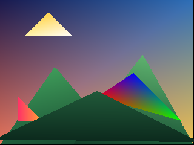

# tinyraster

A triangle rasterizer in under 400 lines of SystemVerilog, checked pixel for pixel against a C model. It uses the edge-function method with a top-left fill rule and gives each pixel an interpolated RGB colour.



*320x240, 8 triangles, drawn by the RTL under Icarus Verilog. [Scan order](docs/images/scan.gif).*

Nothing here has been built on a board. Everything is simulation plus synthesis and place-and-route reports.

## Run it

You need `iverilog`, `yosys` and a C compiler.

```
make test      # about a minute
make render    # rewrites docs/images/demo.png
make synth     # yosys, iCE40
```

`make test` runs three checks:

| check | what | result |
|---|---|---|
| random | 4000 triangles: clipped, off-screen, degenerate, 12-bit extremes, 1-pixel | 1,357,856 pixels, identical to `model/raster.c` |
| edge | 16 hand-written corner cases in `scenes/edge_cases.txt` | 13,397 pixels, identical |
| quads | 500 parallelograms, each split along both diagonals | same pixel set from both splits, no pixel drawn twice |

The quads test does not use the C model, so it still means something if the model and the RTL share a bug. Forcing the fill rule to "edges always inclusive" makes it report 2,889 overlapping pixels.

## Using the module

```systemverilog
tinyraster #(.SW(320), .SH(240)) raster (
    .clk, .rst,
    .in_valid, .in_ready,
    .x0, .y0, .x1, .y1, .x2, .y2,        // signed 12-bit pixel coordinates
    .rgb0, .rgb1, .rgb2,                 // 24-bit 0xRRGGBB at each vertex
    .px_valid, .px_x, .px_y, .px_rgb,    // one pixel per clock while px_valid
    .tri_done                            // one-clock pulse, also for empty triangles
);
```

Pixels come out row by row from the top-left of the clipped bounding box. Hand it the next triangle once `in_ready` is high. There is no framebuffer or depth buffer; `tb/tb_tinyraster.sv` shows how to consume the stream.

## Numbers

Timing is from nextpnr 0.11.1 with one default seed, so treat it as indicative.

| target | size | speed |
|---|---|---|
| Lattice ECP5 LFE5U-25F | 2,869 LUT4, 2,544 FF, 5 MULT18X18D | 38 MHz |
| iCE40 (Yosys only) | 6,378 LUT4 | does not fit HX8K: 7,955 of 7,680 logic cells after packing |

Cycle cost is about 200 clocks of setup plus one clock per pixel of the clipped bounding box. In the demo scene that is 255,297 clocks for 124,032 drawn pixels, so about half the clocks are spent on pixels outside the triangle. Skipping them is the obvious next step; see below.

## Layout

```
rtl/tinyraster.sv   setup sequencer, scan loop
rtl/tr_div.sv       restoring divider
model/raster.c      reference model, random and quad generators, checkers
tb/                 testbench (reads triangles from a text file, logs pixels)
scenes/             demo scene and edge cases
tools/              PNG writer in C, animation script (Pillow)
docs/architecture.md
```

How the arithmetic works, including why the colour accumulators wrap on purpose, is in [docs/architecture.md](docs/architecture.md).

## Known limits

- Vertices are integers. No sub-pixel precision, so edges of moving triangles will crawl.
- Colour is interpolated linearly in screen space, not perspective-correct.
- Bounding-box scan wastes cycles on thin triangles. A skip-ahead per row or a 2x2 quad walk would fix it.
- Three 52-bit dividers dominate the area. One shared divider would shrink it at the price of about 310 more setup clocks. I have not measured by how much.
- Tested with Icarus Verilog only. Verilator has not been tried.
- Coordinates are 12-bit signed and the screen is at most 2048x2048.

## Why this exists

Rasterization is the part of a GPU people most want explained, and most explanations are either a software loop or a full pipeline that takes weeks to read. This is one module you can read in an afternoon, with a model next to it to diff against.

CERN-OHL-P-2.0. Issues with a failing triangle line are the most useful kind; see [CONTRIBUTING.md](CONTRIBUTING.md).
